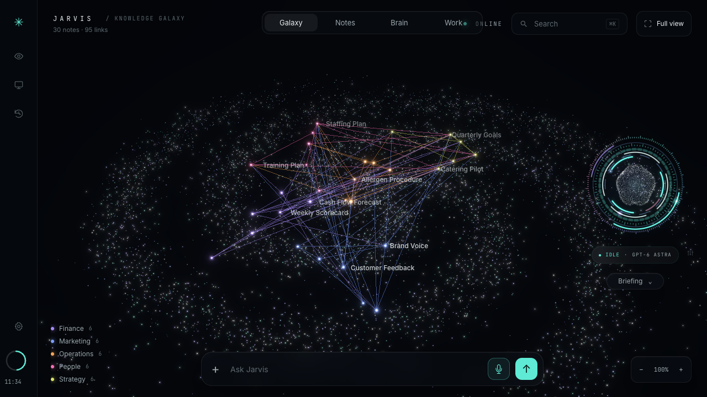
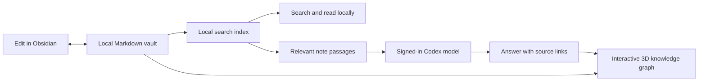

# Jarvis

A project by [Nivaen Giritharan](https://github.com/fwnivaen).

**Turn your Obsidian vault into an interactive 3D knowledge graph — then ask questions grounded in your notes.**

Jarvis is a local Python app with a browser dashboard for connected Markdown notes, cited answers, and optional agent workflows. Open the same vault in Obsidian and Jarvis: your files remain ordinary Markdown, with no Obsidian plugin or account required.

[](https://github.com/fwnivaen/git-jarvis/actions/workflows/ci.yml)
[](LICENSE)

[Quick start](#quick-start) · [Connect Obsidian](#connect-your-obsidian-vault) · [User guide](docs/USAGE.md) · [Contributing](CONTRIBUTING.md)



## Obsidian → knowledge graph → grounded answers



`[[Wikilinks]]`, Markdown note links, aliases, and tags connect your knowledge. Search locally in **Brain**, inspect a note in **Notes** or the galaxy, and follow answer citations back to the original source. Brain search and explicit note lookups make **no model calls**; reasoning questions send selected passages to your signed-in Codex model.

The repository includes **30 fictional café-business notes** so you can explore the graph before connecting your own vault. [Connect an existing vault or create a new one ↓](#connect-your-obsidian-vault)

## What you can use

| Capability | What it does |
| --- | --- |
| **Shared Obsidian vault** | Index the same Markdown files you edit in Obsidian; refresh changes and open sources in either app. |
| **3D knowledge graph** | Explore note relationships, search the galaxy, and navigate linked sources. |
| **Grounded Q&A** | Ask about your notes and inspect the cited sources. General chat is also available. |
| **Note capture and editing** | Save a thought, read a note, and edit with revision checks to prevent stale overwrites. |
| **Optional agent workflows** | Enable bounded delegation, peer review, visible progress, cancellation, and checkpoint recovery. |
| **Optional memory and imports** | Add local semantic search, explicit saved preferences, and PDF/DOCX/XLSX text import. |

Voice, camera posture cues, and screen sharing are optional controls, described with their permissions and limits in the [user guide](docs/USAGE.md). Native helpers require macOS. Focus timers and activity tracking are removed.

## Quick start

### 1. Requirements

- **Python 3.11+** and Git. The basic server and viewer need no Python packages or frontend build.
- A modern browser with WebGL; Chrome is the recommended browser for the dashboard.
- For AI answers: an installed [Codex CLI](https://learn.chatgpt.com/docs/cli), signed in with **ChatGPT**, with access to the configured models and available included usage. See [authentication](https://learn.chatgpt.com/docs/auth?surface=cli).
- macOS for native voice and desktop helpers. The core server is also regression-tested on Linux; Windows/native feature parity is not established.

You can explore the demo graph and note viewer before signing in. Model answers require the account connection; they are not offline inference. Node.js is only needed for developer checks.

### 2. Clone and launch the demo

```sh
git clone https://github.com/fwnivaen/git-jarvis.git
cd git-jarvis
./start.sh
```

Open **[http://127.0.0.1:4700](http://127.0.0.1:4700)**. Keep the terminal open; **Control+C** stops Jarvis. The launcher builds the demo graph, and the server creates a private, git-ignored `config.json` if none exists. No API key is needed.

Before asking for an AI answer, sign in through the normal Codex flow:

```sh
codex login
codex login status
```

Choose ChatGPT sign-in. This build allows the included Codex route and blocks separately billed API backends, including OpenRouter. Account/model access and usage limits still apply; Jarvis does not claim unlimited or free inference. [Usage policy](docs/usage-policy.md)

### 3. Try it

- Open **Notes**, choose **Cash Flow Forecast**, and follow a linked note in the galaxy.
- Ask: **“Who updates the Cash Flow Forecast, and when?”** Inspect the returned sources.
- Connect an Obsidian vault using the steps below, then use **Brain → Search locally** to find a fact without a model request.

## Connect your Obsidian vault

### Use an existing vault

Stop Jarvis with **Control+C** in its terminal. Replace the example path with the absolute path to your vault:

```sh
python3 tools/setup_brain.py --connect "$HOME/Documents/My Vault"
./start.sh
```

Open **Brain** and confirm it shows your vault as connected. Jarvis indexes that folder directly; connecting does not copy or rewrite your existing notes. The included demo notes stay in the repository. Vault selection takes effect at startup.

### Start a new vault

In **Brain**, choose **Prepare this folder** to create a separate starter vault at `~/Documents/Jarvis Brain`. Restart Jarvis, then in Obsidian choose **Open folder as vault** and select that folder. If the folder already exists, use the existing-vault command instead; preparation never overwrites it.

After editing in Obsidian, choose **Brain → Refresh notes** to update the galaxy. Source retrieval also refreshes the index. **Open in Obsidian** uses the native app link and may prompt your browser for permission.

Hidden paths, `Private`, `Secrets`, symlinks, and notes marked `jarvis_private: true` are excluded. The supported scope is 1,000 Markdown notes, 800,000 bytes per note, and 64 MiB of vault text. Read the [Obsidian guide](docs/OBSIDIAN-BRAIN.md) for privacy properties, supported syntax, disconnecting, and troubleshooting.

## Optional upgrades

### Agent workflows, semantic search, and imports

```sh
python3 tools/setup_ultra.py --no-model
python3 tools/ultra_settings.py enable
./start.sh
```

This installs pinned dependencies in a project-local environment and enables Ultra. `--no-model` skips the embedding-model download; keyword search remains available. Run setup again without that flag when you want local semantic embeddings.

For the separate **Work** workflow server, stop the existing server first, then run:

```sh
./start-workflows.sh
```

Choose **Work** in the dashboard. See the [workflow guide](docs/WORKFLOWS.md) for launching and recovering tasks, and the [Ultra guide](ULTRA-JARVIS.md) for model presets, budgets, and feature flags. Configured model IDs must be available to your account; unavailable models are refused.

### Native macOS voice

Install Apple's Xcode Command Line Tools, then build the speech helper:

```sh
xcode-select --install
sh native/build_voice.sh
```

Enable microphone/speech access when macOS asks. Global shortcuts and the desktop voice UI use a separate helper; see [local controls](docs/LOCAL-CONTROLS.md). Physical microphone, audible output, and Accessibility behavior need checks on your Mac.

## Configuration and privacy

- **`config.json`** holds local backend/model settings. First launch creates it with private permissions. The [minimal example](config.json.example) documents the supported default; edit your existing file locally instead of replacing it.
- **[`ultra.json`](ultra.json)** holds optional feature flags, models, and budgets. Ultra is **off** in a fresh clone.
- Personal notes belong in your external vault. The `notes/` demo is tracked by Git; captures and imports under its dedicated folders are ignored.
- Notes, local indexes, and saved work live on your machine. Model requests send relevant passages/conversation context; an explicit vision request can send an image. Browser speech services may process audio depending on your browser. [Data and permission details](docs/USAGE.md)
- The server binds to loopback. It is a single-user local app; do not expose it as a public or shared web service. `config.json`, generated graph data, and `.local/` runtime files are excluded from commits.

## Checks

```sh
python3 tools/check_repo.py      # repository hygiene and local documentation links
python3 tools/check_ultra.py     # Python and JavaScript regressions; requires Node.js
python3 preflight.py            # running-server checks and real model calls
```

Preflight preserves vault notes by default and reports the capture/cleanup test as skipped. Only use `--allow-capture-cleanup` if you want it to create and delete one disposable verification note. `--quick` skips model inference and labels those checks as warnings.

[Verification record](docs/VERIFICATION.md) · [Contributing and test setup](CONTRIBUTING.md)

## Troubleshooting

| Symptom | What to check |
| --- | --- |
| Python syntax/version error | Check `python3 --version`; use Python 3.11+ for the documented setup. |
| Port 4700 is occupied | Stop your existing Jarvis instance in its terminal before launching another. |
| Graph works, but answers fail | Check `codex login status`, model access, available allowance, and **Settings → Readiness**. An API key does not enable another provider. |
| Vault remains on the demo notes | Run the connect command with your vault's absolute path, restart the server, and reload the browser. |
| Obsidian edits are missing | Choose **Brain → Refresh notes**. Check the note is Markdown and not excluded by its path or privacy properties. |
| Invalid local configuration | Fix the JSON in your existing `config.json` using the minimal example. Preserve your settings; do not post the file in an issue. |
| Semantic search is unavailable | Install the optional embedding model or continue with keyword search. |
| Voice is unavailable | Check the helper build, on-device recognition, and macOS microphone/speech permissions. |

## How it is built

| Area | Technology / entry points |
| --- | --- |
| Local server | Python standard library HTTP server — [server.py](server.py) |
| Shared Markdown and search | SQLite FTS5, wikilinks and privacy filtering — [obsidian_brain.py](obsidian_brain.py), [vault_files.py](vault_files.py) |
| 3D dashboard | Plain JavaScript and bundled Three.js; no npm build — [viewer/](viewer/) |
| Agent runtime | Bounded routing, typed tools and checkpoints — [ultra.py](ultra.py), [codex_bridge.py](codex_bridge.py) |
| Optional integrations | LangGraph/SQLite workflows, Qdrant/FastEmbed, document readers, MCP stdio adapter |
| Native helpers | Swift speech, screen-watch and desktop controls — [native/](native/) |

[Architecture](docs/ARCHITECTURE.md) · [Documentation index](docs/README.md) · [Third-party notices](THIRD_PARTY.md) · [MIT license](LICENSE)
