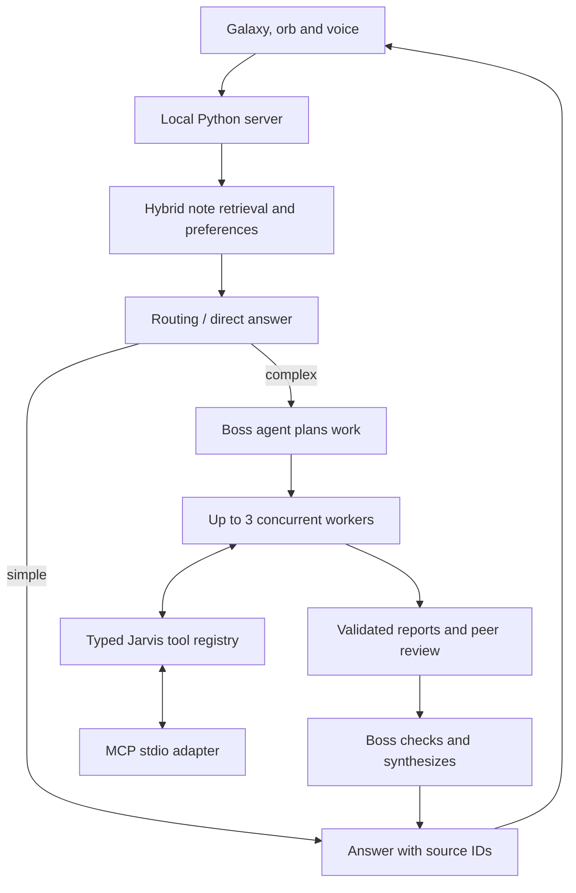

# Jarvis · Ultra Jarvis

A personal AI assistant for macOS that connects a Markdown knowledge vault, a 3D knowledge graph, voice, and a bounded team of collaborating AI agents — all running locally.

[](https://github.com/fwnivaen/Jarvis/actions/workflows/ci.yml)
[](LICENSE)


## Overview

Jarvis runs on a local Python HTTP server with a dependency-free JavaScript viewer and native macOS Swift helpers for voice and screen-watch. Your notes, search indexes, and runtime state stay on your machine — nothing is uploaded except the specific note excerpts or vision frames a request needs. The repository ships with a small, fictional 30-note "café business" vault so the whole system works out of the box with no setup beyond installing dependencies.

Model requests go through a signed-in ChatGPT/Codex CLI session (no separate API billing) or, optionally, OpenRouter if you supply your own key. See [docs/usage-policy.md](docs/usage-policy.md) for the exact data-handling policy.

## Features

- **Grounded knowledge graph** — search Markdown notes, follow citations into an interactive 3D galaxy (Three.js), capture new notes, and edit with revision checks.
- **Multi-agent collaboration** — a "boss" agent plans work and assigns it to up to three "worker" agents, who share findings and get peer-reviewed before the boss synthesizes one final answer. Simple questions skip straight to a single cheap call.
- **Live agent visualization** — compact status signals glow in the galaxy as agents work, with a detailed drawer showing tool calls, timing, retries, and token usage.
- **Hybrid memory** — local semantic + keyword search, PDF/DOCX/XLSX text import, and persistent preferences.
- **Voice and vision** — an animated orb UI, native macOS speech recognition/synthesis, local posture tracking, explicit camera snapshots, and screen-watch with local frame comparison.
- **MCP tool server** — the same note/preference/document/screen-watch tools are exposed over an MCP stdio adapter for use from other MCP clients.
- **Visible agent workflows** — a dedicated "Work" view shows real parallel agent runs with cancel/retry and checkpoint recovery.

## Architecture



See [docs/ARCHITECTURE.md](docs/ARCHITECTURE.md) for the full request lifecycle, module responsibilities, and failure/recovery semantics.

## Screenshots

| Agent collaboration | Workflows |
| --- | --- |
|  |  |

More screenshots: [docs/screenshots/](docs/screenshots/).

## Tech stack

| Layer | Technology |
| --- | --- |
| Server | Python 3 standard library (`http.server`), optional LangGraph + SQLite checkpoints for workflows |
| Viewer | Plain JavaScript, custom Three.js renderer — no frontend build step |
| Voice / vision helpers | Swift (AVFoundation, Speech, AppKit) compiled to small macOS helper apps |
| Model backend | ChatGPT/Codex CLI (default) or OpenRouter (optional, bring your own key) |
| Optional memory | Qdrant (embedded, local) + FastEmbed for semantic search |
| Tests | Python `unittest` (500+ tests), Node's built-in test runner for the viewer |

## Prerequisites

- macOS with Xcode Command Line Tools (`xcode-select --install`) — needed to compile the native voice/screen-watch helpers.
- Python **3.11+**.
- [Node.js](https://nodejs.org/) — only needed to run the viewer regression checks.
- Google Chrome (or any modern browser) to use the viewer.
- A signed-in, working [Codex CLI](https://github.com/openai/codex) install — this is the default model backend and needs no separate API key.
  - Alternative: skip Codex and supply your own `openrouter_api_key` in `config.json` (see [Configuration](#configuration)) to use OpenRouter models instead.

## Setup

```sh
git clone https://github.com/fwnivaen/Jarvis.git
cd Jarvis
python3 tools/setup_ultra.py       # optional: installs local embeddings for semantic search
python3 tools/ultra_settings.py enable
./start.sh
```

Open [http://localhost:4700](http://localhost:4700) in Chrome. The server creates its own private `config.json` on first run — no manual setup is required for the default Codex backend.

To run the original, minimal path without the optional packages or native helpers:

```sh
python3 build.py
python3 server.py
```

For Python version selection, optional flags, and troubleshooting, see the [complete setup guide](ULTRA-JARVIS.md).

### Visible agent workflows

```sh
./start-workflows.sh
```

Open [http://localhost:4700](http://localhost:4700) and select **Work** to launch a task and watch real parallel agents run. See [docs/WORKFLOWS.md](docs/WORKFLOWS.md).

## Configuration

Jarvis stores its settings in a local, git-ignored **`config.json`** at the repo root (not a `.env` file — the server reads no environment variables for its own configuration). A template with every supported key is provided at [`config.json.example`](config.json.example); copy it to get started:

```sh
cp config.json.example config.json
```

| Key | Purpose |
| --- | --- |
| `brain` | Model backend: `"codex-cli"` (default, uses your signed-in Codex session) |
| `model` | Model ID to request from the backend, e.g. `"gpt-6-astra"` |
| `openai_api_key` | Only used by optional direct-OpenAI code paths; leave as the placeholder if you only use Codex |
| `openrouter_api_key` | Optional: your own [OpenRouter](https://openrouter.ai/) key, to use OpenRouter models instead of Codex |

If you omit `config.json` entirely, the server writes one for you on first launch with safe placeholder values.

Two environment variables affect the **build scripts only** (not runtime config): `JARVIS_VOICE_APP_PATH` and `JARVIS_SWIFT_MODULE_CACHE`, both optional overrides for where the compiled native helper apps land.

## Usage

- Ask questions grounded in the included vault, e.g. *"Who updates the Cash Flow Forecast, and when?"*
- Request multi-agent collaboration explicitly, e.g. *"Use three workers to compare Menu Pricing, Opening Checklist and Launch Campaign."*
- Save a preference: *"Remember that the supplier review is next Tuesday."*
- Import a document from **Notes**, or add an explicit preference in **Settings**.
- Hold **Control–Shift–Space** to speak, **Option–Escape** to cancel, **Option–Command–M** to mute (requires the native voice helper).

## Verify it

```sh
python3 tools/check_repo.py          # repository hygiene (links, private-file leaks)
python3 tools/check_ultra.py         # full Python + viewer regression suite
python3 preflight.py                 # live checks against a running server (needs model access)
```

CI (`.github/workflows/ci.yml`) runs the regression suite on Linux and compiles the native macOS helpers on `macos-latest`, without any account credentials or physical sensor access.

## Troubleshooting

| Symptom | Likely cause / fix |
| --- | --- |
| `./start.sh` exits immediately with a model/backend error | Codex CLI isn't installed or isn't signed in. Run `codex` directly to check, or switch to OpenRouter in `config.json`. |
| Native voice helper fails to build | Confirm Xcode Command Line Tools are installed and up to date: `xcode-select --install`. |
| Microphone / speech doesn't work | Grant Microphone and Speech Recognition permissions to the compiled helper app in **System Settings → Privacy & Security**. |
| Blank or stale galaxy after editing notes | Re-run `python3 build.py` to regenerate `viewer/graph-data.js`, or restart the server. |
| `config.json` seems to have the wrong shape | Delete it and restart — the server recreates it with safe defaults on next launch. |
| Semantic search says "not ready" | Run `python3 tools/setup_ultra.py` to install the optional local embedding model. |

## Explore the code

| Area | Start here |
| --- | --- |
| HTTP boundaries, retrieval and existing behavior | [server.py](server.py) |
| Routing, budgets, validation and collaboration | [ultra.py](ultra.py), [codex_bridge.py](codex_bridge.py) |
| Memory and document conversion | [ultra_memory.py](ultra_memory.py), [ultra_documents.py](ultra_documents.py) |
| Shared tools and checkpoint recovery | [ultra_tools.py](ultra_tools.py), [ultra_workflows.py](ultra_workflows.py) |
| Galaxy, orb and live crew | [viewer/](viewer/) |
| Voice and desktop helpers | [voice_bridge.py](voice_bridge.py), [native/](native/) |
| Regression checks | [tests/](tests/), [CI workflow](.github/workflows/ci.yml) |

[Architecture](docs/ARCHITECTURE.md) · [Usage](docs/USAGE.md) · [Documentation index](docs/README.md) · [Third-party notices](THIRD_PARTY.md)

## License

[MIT](LICENSE)
