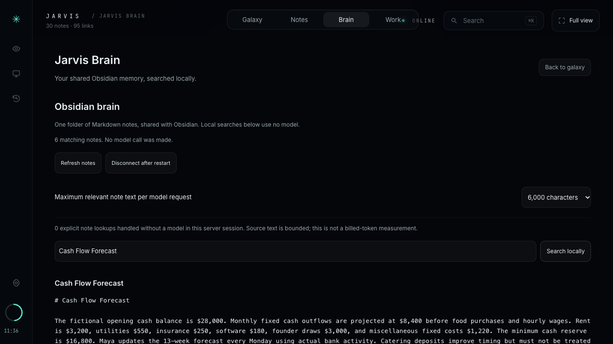

# Connect Obsidian to the Jarvis knowledge graph

Obsidian and Jarvis share **one folder of ordinary Markdown files**. Obsidian is your editor; Jarvis indexes the same notes for local search, the interactive 3D graph, and sourced model answers. No Obsidian plugin, account, sync subscription, or API key is required for the connection.



## Connect an existing vault

1. Stop Jarvis with **Control+C** in the terminal where it is running.
2. From the repository root, select the absolute path to your vault:

   ```sh
   python3 tools/setup_brain.py --connect "$HOME/Documents/My Vault"
   ./start.sh
   ```

   Replace `My Vault` with your actual folder. Selecting a vault does not copy, move, or rewrite its notes. The private selection is stored under `.local/obsidian/`, outside Git.
3. Open [http://127.0.0.1:4700](http://127.0.0.1:4700) and choose **Brain**. Confirm the connected vault name and indexed note count.
4. Use **Search locally**, select **Read in Jarvis**, or return to the galaxy to explore the links. Ask a question when you want a model to reason over relevant passages.

Vault selection applies at server startup. A selection made while Jarvis is running is marked as requiring a restart; active tasks keep their original scope. The included café demo remains in `notes/`.

## Create a new vault

In **Brain**, choose **Prepare this folder**. It creates a private starter at `~/Documents/Jarvis Brain` with a start guide, About me, a project note, and memory rules, plus folders for Inbox, Knowledge, Projects, Decisions, Daily, and Private. It also selects the folder for the next launch.

Restart Jarvis, then in Obsidian choose **Open folder as vault** and select `Jarvis Brain`. Obsidian must be installed separately if you want to edit there. The web dashboard and Markdown connection do not require the Obsidian app to be running.

Preparation refuses to overwrite an existing folder. If you already have a vault at that location, use the existing-vault command above.

For another new location, prepare and connect explicitly:

```sh
python3 tools/setup_brain.py --prepare "$HOME/Documents/Research Brain"
python3 tools/setup_brain.py --connect "$HOME/Documents/Research Brain"
./start.sh
```

The parent folder must already exist. Stop the old Jarvis instance before launching the new one.

## Make the graph useful

- Link related notes with `[[Note Title]]` or standard Markdown links to other notes in your vault.
- Use a note's `aliases` property for alternate names and `tags` for context.
- Edit in Obsidian or Jarvis. **Brain → Refresh notes** reconciles changes in the galaxy. Source retrieval refreshes the index before using passages.
- Follow a citation or choose **Read in Jarvis** to inspect its exact source. **Open in Obsidian** opens the original note through `obsidian://`; your browser may ask to open the app.

The parser supports a bounded subset of Markdown and note properties. It is not a full YAML parser, Obsidian plugin engine, or renderer for every embed/canvas format.

## Search without a model call

**Brain → Search locally** uses SQLite FTS5. With a connected vault, explicit chat requests such as **“Search my notes for supplier review”** and **“Read note About me”** also return local note content without model inference. Use a full title, path, or alias if the title is ambiguous.

A reasoning question uses the configured signed-in Codex route. Selected note passages share a default **6,000-character** budget, adjustable from 1,000 to 12,000 in Brain; recent conversation context is bounded to 3,000 characters. The whole vault is not put into each prompt. Counters describe this server session's local lookups and source characters, not billed tokens or a promised percentage of savings.

## Privacy and supported scope

Jarvis supports up to **1,000 Markdown files**, **800,000 bytes per note**, and **64 MiB of vault text**. It excludes hidden paths, `Private`, `Secrets`, symlinks, and notes marked private/excluded. To exclude a note, place this property at the top:

```yaml
---
jarvis_private: true
---
```

Common quoted booleans and comments are accepted. Unknown or incomplete privacy metadata is excluded. Private folders are a search exclusion, not encryption.

Relevant passages can leave your machine through a model request. Notes remain untrusted source material and cannot grant tools permission. A changed, removed, or newly private source invalidates an in-flight source receipt; Jarvis requests a fresh question rather than returning a stale answer.

Excluding a note affects subsequent successful index refreshes. It does not erase earlier exports, retained tasks, or approval receipts. [Saved task privacy](TASK-PRIVACY.md) documents the separate review and removal controls. Keep your own vault backups; this connection is not a complete backup/restore system.

## Disconnect or switch vaults

Stop Jarvis, then run:

```sh
python3 tools/setup_brain.py --disconnect
./start.sh
```

This returns to the included demo on the next launch. No vault files are deleted. **Brain → Disconnect after restart** stages the same change from the dashboard.

To switch, stop Jarvis and run `--connect` with the other vault's absolute path. Inspect pending/current selection with `python3 tools/setup_brain.py`. Use `--help` for the context-budget and private state-directory options.

## Troubleshooting

| Problem | Check |
| --- | --- |
| Still seeing the café demo | Confirm the connect command succeeded, restart Jarvis, and reload the browser. |
| Folder cannot be selected | Use an absolute path to a regular, existing vault folder, not your home/root folder or a symlink. |
| A note is missing | Check its `.md` extension, path, privacy properties, supported size, and the collection limits. Refresh again. |
| “Open in Obsidian” does nothing | Install Obsidian and allow the native app link in your browser. Reading in Jarvis remains available. |
| Vault moved since the last launch | Restore the folder or explicitly disconnect/reconnect before restarting. |

## References

[How Obsidian stores notes](https://help.obsidian.md/Files+and+folders/How+Obsidian+stores+data) · [Internal links](https://help.obsidian.md/Linking+notes+and+files/Internal+links) · [Obsidian URI](https://help.obsidian.md/Extending+Obsidian/Obsidian+URI) · [Download Obsidian](https://obsidian.md/download)
